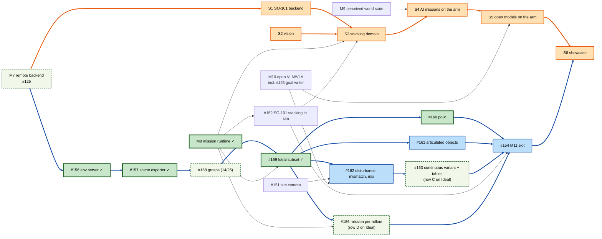

# Roadmap

Where `long_tamp` is going after 0.1.0, and how progress is tracked. The design
behind it is in the ADRs ([adr/](../adr/README.md)); the process is in
[development/workflow.md](../development/workflow.md).

**Tracker:** each milestone below is a GitHub milestone, each item a GitHub issue
([issues](https://github.com/thanhndv212/long-tamp/issues),
[milestones](https://github.com/thanhndv212/long-tamp/milestones)). This page is the
overview; issue status on GitHub is authoritative. Tick an item here when its issue
closes.

## Direction

Today the task level is written by hand and `task_planning/` compiles a hand-written plan
into a BehaviorTree.CPP tree. The target splits the stack into three pluggable roles
([ADR-0001](../adr/0001-planner-refiner-executor.md)):

- a **task planner** decides which discrete actions to take, in what order (hand-written, a
  classical PDDL planner, PDDLStream, or a language model producing the *goal*);
- a **refiner**, long_tamp's core, binds them to continuous grasps, configurations and
  paths on HPP's manipulation constraint graph;
- an **executor** runs the result (Python by default, BehaviorTree.CPP as an export,
  robot or simulator backends), with effects checked against the world so missions skip
  what's already done and resume after a restart
  ([ADR-0002](../adr/0002-effects-as-runtime-guards.md)).

Every milestone is delivered and proven on the screw-assembly mission first
([ADR-0003](../adr/0003-screw-assembly-reference-track.md)). Each milestone gate must
keep the V3 batch gate green ([validation](../development/validation.md)).

## M1 — State model and effect-based resume (0.2.0)

**Released as 0.2.0 on 2026-09-28.**

[Milestone 1](https://github.com/thanhndv212/long-tamp/milestone/1)

Capabilities declare what they need and what they achieve; plans are checked for
feasibility before any geometry runs; missions skip steps whose effect already holds.

- [x] [#2](https://github.com/thanhndv212/long-tamp/issues/2) Typed preconditions and effects on `CapabilityDescriptor`; `TaskPlan.from_dict`
      simulates them and rejects infeasible plans; `TaskStepReady` checks preconditions
- [x] [#3](https://github.com/thanhndv212/long-tamp/issues/3) World-state provider: observed predicates (grasps, poses) and recorded facts
      (written only by completed execution, e.g. `screwed(part, hole)`)
- [x] [#4](https://github.com/thanhndv212/long-tamp/issues/4) Runtime effect guard: a transaction is skipped when its effect already holds
      (replaces the in-memory completed set)
- [x] [#5](https://github.com/thanhndv212/long-tamp/issues/5) Screw-assembly domain and mission expressed as a TaskPlan (`plan_block`,
      `home_move` capabilities)
- [x] [#6](https://github.com/thanhndv212/long-tamp/issues/6) Initial-state scenario harness (V4), ≥4 screw-assembly scenarios, TWIN regrasp
      from ≥3 initial grasp states
- [x] [#7](https://github.com/thanhndv212/long-tamp/issues/7) Static plan diagram: `to_mermaid()` / `to_dot()` for TaskPlans

**Exit test:** the screw-assembly TaskPlan succeeds from ≥4 initial states with no plan
change; the 10-seed batch gate passes.

## M2 — Executor contract and refiner interface (0.3.0)

**Released as 0.3.0 on 2026-09-28.**

[Milestone 2](https://github.com/thanhndv212/long-tamp/milestone/2)

- [x] [#8](https://github.com/thanhndv212/long-tamp/issues/8) Executor contract: statuses `SUCCESS/FAILURE/RUNNING/BUSY`, heartbeats with
      inactivity timeouts, duration-scaled execution timeouts, pause/resume/breakpoints
- [x] [#9](https://github.com/thanhndv212/long-tamp/issues/9) Python executor for TaskPlans (default), with mock and trajectory-playback backends
- [x] [#10](https://github.com/thanhndv212/long-tamp/issues/10) `Refiner` interface over `run_block_with_recovery()` and the phase-target lookahead
- [x] [#11](https://github.com/thanhndv212/long-tamp/issues/11) Structured JSONL event stream from the executor; the BehaviorTree.CPP host emits
      the same stream (IR ids stamped on compiled nodes)
- [x] [#12](https://github.com/thanhndv212/long-tamp/issues/12) Resume from world state after the process is killed mid-mission

**Exit test:** batch gate passes on the Python executor; a mission killed mid-run
resumes from world state, not from a block index.

## M3 — Automatic task planning (0.4.0)

**Released as 0.4.0 on 2026-09-29.**

[Milestone 3](https://github.com/thanhndv212/long-tamp/milestone/3)

- [x] [#13](https://github.com/thanhndv212/long-tamp/issues/13) PDDL domain/problem export from the capability registry and a goal
- [x] [#14](https://github.com/thanhndv212/long-tamp/issues/14) Unified Planning adapter (Fast Downward) producing plan skeletons → TaskPlan
- [x] [#15](https://github.com/thanhndv212/long-tamp/issues/15) Structured refiner failure facts (`CanNotReach`, `IKUnreachable`,
      `ReleaseEdgeInfeasible`, `Blocks`) and a block → replan loop
- [x] [#16](https://github.com/thanhndv212/long-tamp/issues/16) Screw-assembly domain with real choices: clamp slot, part order, driving arm

**Exit test:** an N-part screw-assembly goal is planned automatically; an injected
`CanNotReach` triggers a re-clamp and the mission completes.

## M4 — Execution in simulation and controllers (0.5.0)

**Released as 0.5.0 on 2026-09-30.**

[Milestone 4](https://github.com/thanhndv212/long-tamp/milestone/4)

- [x] [#17](https://github.com/thanhndv212/long-tamp/issues/17) MuJoCo scene export (MJCF from the example's URDFs)
- [x] [#18](https://github.com/thanhndv212/long-tamp/issues/18) MuJoCo execution backend: trajectory tracking controller, gripper actuation
- [x] [#19](https://github.com/thanhndv212/long-tamp/issues/19) Skill capabilities (pre/post conditions, start/end poses) and a screwing skill stub
- [x] [#20](https://github.com/thanhndv212/long-tamp/issues/20) Drift check before executing a cached plan; replan from observed state;
      plan-ahead in a planner process
- [x] [#67](https://github.com/thanhndv212/long-tamp/issues/67) The UR10 from Universal Robots' own description package
- [x] [#71](https://github.com/thanhndv212/long-tamp/issues/71) The Robotiq 2F-85 from PickNik's ros2_robotiq_gripper, with contact grasps in MuJoCo

**Exit test:** a full two-part mission executes in simulation with tracking control;
injected drift triggers a replan and the mission completes.

## M5 — Multi-arm partial-order execution

**Released as 0.6.0 on 2026-10-01.**

[Milestone 5](https://github.com/thanhndv212/long-tamp/milestone/5)

- [x] [#21](https://github.com/thanhndv212/long-tamp/issues/21) Partial-order plan skeletons (precedence constraints); concurrent arm execution
      where the domain allows; BehaviorTree.CPP export lowers to `Parallel` + sync

**Exit test:** the parallel mission beats the sequential baseline's wall-clock time.
Revisit against ScheduleStream before starting.

## M6 — AI model integration

**Released as 0.7.0 on 2026-10-01.**

[Milestone 6](https://github.com/thanhndv212/long-tamp/milestone/6) · Design:
[ADR-0006](../adr/0006-ai-model-integration.md)

Any model, through one gateway; models act through typed, checked roles and gated tools;
interactive and autonomous operation. A model writes the problem, never the plan (ADR-0001).

- [x] [#22](https://github.com/thanhndv212/long-tamp/issues/22) A model writes a mission's
      goal from an instruction, through the same validation gate (PR #85)
- [x] [#86](https://github.com/thanhndv212/long-tamp/issues/86) One model gateway for
      Anthropic- and OpenAI-compatible APIs (`long_tamp.ai`)
- [x] [#87](https://github.com/thanhndv212/long-tamp/issues/87) Typed model roles (contracts,
      checkers, fallbacks); grounder and plan reviewer
- [x] [#88](https://github.com/thanhndv212/long-tamp/issues/88) Execution supervisor role with
      autonomy limits and escalation
- [x] [#89](https://github.com/thanhndv212/long-tamp/issues/89) Interactive mission session:
      gated tools and a terminal chat
- [x] [#91](https://github.com/thanhndv212/long-tamp/issues/91) Exit test

**Exit test:** from one instruction, the screw-assembly mission runs in MuJoCo to the end with
no human input, through an injected failure that needs a goal-level decision, or it stops
within its limits with an escalation report.

## 0.8.0: the mission UI (from the backlog)

**Released as 0.8.0 on 2026-10-02.** Picked from the backlog after M6:

- [x] [#24](https://github.com/thanhndv212/long-tamp/issues/24) Web mission viewer on the event stream (`long_tamp.viewer`)
- [x] [#90](https://github.com/thanhndv212/long-tamp/issues/90) Chat panel in the viewer (`ChatBridge`)
- [x] [#104](https://github.com/thanhndv212/long-tamp/issues/104) Mission UI: launcher, plan card, Start button, one-screen layout
- [x] [#105](https://github.com/thanhndv212/long-tamp/issues/105) Plan monitor: the plan as a live behavior tree
- [x] [#106](https://github.com/thanhndv212/long-tamp/issues/106) The 3D scene in its own process
- [x] [#108](https://github.com/thanhndv212/long-tamp/issues/108) Progress from a step's planning; skip/abort mid-step
- [x] [#109](https://github.com/thanhndv212/long-tamp/issues/109) Step watchdog (model or rule)
- [x] [#114](https://github.com/thanhndv212/long-tamp/issues/114) Reset mission button

## Hardware showcase track (M7–M11)

After 0.8.0, the goal is to show all of long_tamp on a physical robot, a low-cost SO-101
arm (soarm_tamp, [roadmap](https://github.com/thanhndv212/soarm_tamp/blob/main/docs/roadmap.md),
[tracker](https://github.com/thanhndv212/soarm_tamp/issues/32)): instruction → goal → plan →
refinement → execution on the arm, with a camera keeping the world state current, recovery
from disturbances, and open VLM/VLA models adopted wherever they measurably do better.
These five milestones are the library side. Each is built and tested in simulation first,
and none is SO-101-specific; screw assembly stays the reference track (ADR-0003).

M8 is the gate for the missions: M9, M10 (except #147) and M11's #150 can start alongside M7 and
M8, and M11 gives a sim showcase before the real-arm one. The open benchmark (#156–#163) is the
exception: its env server needs M7's remote backend (#125), its first runs need M8, and it
brings one new library feature, articulated objects (#161).

Orange: the real-hardware path on the SO-101 (soarm_tamp S1–S6, see its
[delivery plan](https://github.com/thanhndv212/soarm_tamp/blob/main/docs/roadmap.md#delivery-plan)).
Blue: the simulated benchmark path (RoboCerebra, #156–#163 and #186, closing M11 with #154).
Uncoloured nodes are the library milestones and sim pieces both paths build on.
Green with ✓: done. Pale green, dashed: partly done (M7 waits on its real-robot exit run,
#158 has handles for every class, but the pick checker passes for 14 of 25, and rows C and D
are in on Ideal only, the other conditions waiting on #162).

## M7 — Hardware execution: remote backends and grippers (0.9.0)

[Milestone 7](https://github.com/thanhndv212/long-tamp/milestone/7)

Run missions on a robot driven from another host (a container and a USB-attached arm, a robot's own controller PC), with grippers beyond symmetric parallel jaws and grasp outcomes checked, not assumed.

- [x] [#125](https://github.com/thanhndv212/long-tamp/issues/125) Remote execution backend over TCP
- [x] [#126](https://github.com/thanhndv212/long-tamp/issues/126) Gripper model interface beyond symmetric parallel jaws
- [x] [#127](https://github.com/thanhndv212/long-tamp/issues/127) Gripper actuation and grasp verification facts
- [x] [#128](https://github.com/thanhndv212/long-tamp/issues/128) Repair from grasp_missed
- [x] [#129](https://github.com/thanhndv212/long-tamp/issues/129) Run long_tamp on your robot
- [ ] [#130](https://github.com/thanhndv212/long-tamp/issues/130) M7 exit test, a mission through RemoteBackend on a real robot
      (the MuJoCo half passed in #171; the SO-101 run is left)

**Exit test:** a mission runs through `RemoteBackend` on the SO-101 (cube pick-and-place, 10 runs, soarm_tamp S1) and the screw assembly runs through it in MuJoCo.

## M8 — Mission runtime as a library (0.10.0)

**Done; milestone closed 2026-10-27, not yet released.**

[Milestone 8](https://github.com/thanhndv212/long-tamp/milestone/8)

The mission runtime that uses every layer (task planner, refiner, executor, repair, supervisor, chat, UI) is about 3,100 lines of `script/screw_assembly/`. Move it into `long_tamp.mission` behind a domain interface, so any robot and task can use the AI features without copying the example.

- [x] [#131](https://github.com/thanhndv212/long-tamp/issues/131) MissionDomain interface and long_tamp.mission package
- [x] [#132](https://github.com/thanhndv212/long-tamp/issues/132) Generic mission runner
- [x] [#133](https://github.com/thanhndv212/long-tamp/issues/133) Generic chat tools and mission UI launcher
- [x] [#134](https://github.com/thanhndv212/long-tamp/issues/134) Run on long_tamp.mission
- [x] [#135](https://github.com/thanhndv212/long-tamp/issues/135) Template domain and "write your own mission" tutorial
- [x] [#136](https://github.com/thanhndv212/long-tamp/issues/136) M8 exit test, two domains on one runtime

**Exit test:** the screw assembly passes the V3 batch gate and the M6 autonomy batch on the library runner; the template domain runs the full loop in the mission UI.

**Passed 2026-10-18 (#136):** V3 gate 10/10, 0/140 replanning blocks, 12/12 recoveries, median 1058 s (dev 1181 s); autonomy batch 0 unclean, 0 unchecked decisions (3 completed, 7 escalated); the template domain planned, ran and was repaired from the mission UI chat. Results: `script/screw_assembly/results/2026-10-18-m8-exit-*.json`.

## M9 — Perception-backed world state (0.11.0)

[Milestone 9](https://github.com/thanhndv212/long-tamp/milestone/9)

Object poses from sensors feed the predicates and the planning scene, and an object moved mid-mission is caught before the step that depends on it.

- [ ] [#137](https://github.com/thanhndv212/long-tamp/issues/137) Observed object poses and geometric predicates
- [ ] [#138](https://github.com/thanhndv212/long-tamp/issues/138) Planning scene from observed poses
- [ ] [#139](https://github.com/thanhndv212/long-tamp/issues/139) Object drift check and replan
- [ ] [#140](https://github.com/thanhndv212/long-tamp/issues/140) Reconcile observation with belief
- [ ] [#141](https://github.com/thanhndv212/long-tamp/issues/141) M9 exit test, object moved mid-mission in MuJoCo

**Exit test:** with a simulated camera in MuJoCo, an object moved mid-mission triggers a replan; 10/10 seeds complete or escalate cleanly.

## M10 — Open VLM/VLA models in the loop (0.12.0)

[Milestone 10](https://github.com/thanhndv212/long-tamp/milestone/10)

Images in the gateway, local open models, VLM roles and learned-policy skills, plus a benchmark that decides where a model replaces a rule (ADR-0006 still holds: a model writes problems and facts, never plans). Runs in parallel with M7–M9: #142–#146 have no dependency on them, and #146 is tested in MuJoCo with a scripted policy; #147 waits for M8's template domain (#135).

- [ ] [#142](https://github.com/thanhndv212/long-tamp/issues/142) Open models in the loop, adopted by measurement
- [ ] [#143](https://github.com/thanhndv212/long-tamp/issues/143) Image inputs in the model gateway
- [ ] [#144](https://github.com/thanhndv212/long-tamp/issues/144) Local open-model serving profile
- [ ] [#145](https://github.com/thanhndv212/long-tamp/issues/145) VLM roles, visual grounder, outcome verifier, failure diagnoser
- [ ] [#146](https://github.com/thanhndv212/long-tamp/issues/146) Learned-policy (VLA) skills
- [ ] [#147](https://github.com/thanhndv212/long-tamp/issues/147) Component benchmark harness
- [ ] [#148](https://github.com/thanhndv212/long-tamp/issues/148) M10 exit test, benchmark report with adoption decisions

**Exit test:** a benchmark report in MuJoCo with an adoption decision per role (keeping the baseline is a valid outcome).

## M11 — Simulation showcase and open benchmark

[Milestone 11](https://github.com/thanhndv212/long-tamp/milestone/11)

The sim half of the showcase, ahead of the real arm: the SO-101 stacking mission end to end in MuJoCo (language goals, simulated camera, disturbances, recovery), runnable by anyone without the hardware, plus an adapter to an open simulated benchmark so long_tamp is measured against published methods. The stacking domain is written once here and reused on the real arm by soarm_tamp S3. Gated on M8; the benchmark also needs #125.

- [x] [#150](https://github.com/thanhndv212/long-tamp/issues/150) Choose the open simulated benchmark
- [ ] [#151](https://github.com/thanhndv212/long-tamp/issues/151) Simulated camera, rendered views and marker poses
- [ ] [#152](https://github.com/thanhndv212/long-tamp/issues/152) SO-101 tabletop stacking in MuJoCo
- [ ] [#153](https://github.com/thanhndv212/long-tamp/issues/153) Open benchmark adapter and baseline runs
- [ ] [#154](https://github.com/thanhndv212/long-tamp/issues/154) M11 exit test, sim showcase and benchmark results

**Benchmark: RoboCerebra** (NeurIPS 2025 D&B, chosen in #150; comparison in [sim-benchmark-selection.md](sim-benchmark-selection.md)). It is long-horizon (about 9
subtasks per task) and scores random disturbances and plan–observation mismatch, which is
long_tamp's replan and recovery story. It runs on LIBERO, so the same adapter later serves
LIBERO-Long and LIBERO-Plus. Published numbers to compare against: GT plan + OpenVLA 25.16,
HPE 16.55; the best reported is SparkVLA's 47.12, under a protocol that may differ. No
planner-based entry has been published. #153 is split into:

- [x] [#156](https://github.com/thanhndv212/long-tamp/issues/156) R1 Env server behind the remote backend protocol (needs #125)
- [x] [#157](https://github.com/thanhndv212/long-tamp/issues/157) R2 MuJoCo model → URDF/SRDF scene exporter
- [ ] [#158](https://github.com/thanhndv212/long-tamp/issues/158) R3 Grasp handle library for the benchmark's object classes
      (handles for all 25 classes; 14 of 25 picked and 4 more held but unregistrable, PR #180)
- [x] [#159](https://github.com/thanhndv212/long-tamp/issues/159) R4 Goal translator, in-hand start state, OSC_POSE tracker; Ideal subset (needs M8)
- [x] [#160](https://github.com/thanhndv212/long-tamp/issues/160) R5 Pour action
- [ ] [#161](https://github.com/thanhndv212/long-tamp/issues/161) R6 Articulated objects: drawers, doors, knobs
- [ ] [#162](https://github.com/thanhndv212/long-tamp/issues/162) R7 Disturbance, mismatch and mix conditions (needs #151, #145)
- [ ] [#163](https://github.com/thanhndv212/long-tamp/issues/163) R8 Continuous variant and results tables
      (row C on Ideal in: 61.4% by Eq. 1; the other conditions wait on #162)
- [ ] [#186](https://github.com/thanhndv212/long-tamp/issues/186) R9 Whole-task planning on `long_tamp.mission` (row D)
      (row D on Ideal in: 64.3% by Eq. 1; follow-ups #187 place on an object, in review in
      PR #192, #188 flat-object grasp, #189 held start in collision, #190 tracker stall)

The first number to publish is the Ideal condition on pick/in/on subtasks (#156 → #159, about
68% of subtasks). Row A is in: 412 of 540 supported segments (76.3%) over 10 Ideal cases ×
10 seeds (`script/robocerebra/results/2026-10-25-r4-ideal-hpp.json`). With pour (#160) the
supported share is 93.4% and 603 of 710 supported segments pass (84.9%), every pour among them
(`script/robocerebra/results/2026-10-29-r5-ideal-hpp-pour.json`). Run through without the resume,
as the published methods run (row C, #163), the policy completes 61.4% of the Ideal tasks' key
state changes by the paper's Eq. 1, and 8 of 100 rollouts complete every step
(`script/robocerebra/results/2026-10-29-r8-ideal-hpp-continuous.json`). Handed to `long_tamp.mission` as one goal a rollout (row D, #186), with the
step budget shared over the rollout, it completes 64.3% (`script/robocerebra/results/2026-10-30-r9-ideal-hpp-mission.json`).
Placing onto another object (#187, PR #192) covers the 15 `On`-over-object goals, all onto
`rack_1`: row A on seed 0 goes from 62/71 to 64/72 supported Ideal steps, none lost, and
the butter and the mug go onto the rack upright in Memory_Execution 1–3. Rows C and D with
it, 10 seeds per Ideal case, are next. Articulated objects (#161) are the critical path to the full table.

**Exit test:** 20 SO-101 sim missions from language instructions with the simulated camera and injected disturbances complete or escalate cleanly; RoboCerebra results for all six conditions committed with seeds (privileged state, simulated camera, continuous variant); a recorded video.

## Backlog (not scheduled)

- [#23](https://github.com/thanhndv212/long-tamp/issues/23) Optional PDDLStream adapter
  (`long-tamp[pddlstream]`), also an independent cross-check (moved out of M6)
- [#98](https://github.com/thanhndv212/long-tamp/issues/98) One live Claude call through the
  gateway (needs API credit; follow-up of #86)
- [#25](https://github.com/thanhndv212/long-tamp/issues/25) BehaviorTree.CPP node plugin library for ROS 2 / Nav2 users: done, `long_tamp_bt_nodes_plugin`
- [#26](https://github.com/thanhndv212/long-tamp/issues/26) Re-enable the spline path optimizer once hpp-core caps the QP solve
  ([bug 6](../bugs/hpp-core-unbounded-planning-loops.md))
- Cross-step backtracking in the refiner, when an example needs it
- ROS 2 bridge example (JTC / MPC execution backends)
